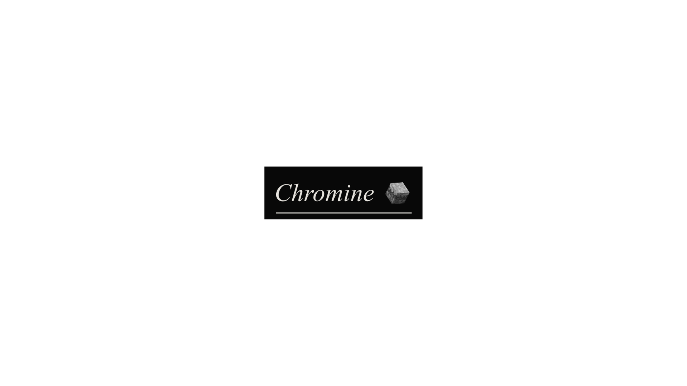

𝐶ℎ𝑟𝑜𝑚𝑖𝑛𝑒 is a semi-auto minecraft server set-up/controler helper.

This will work with :
windows / most linux distros.

goal : 
i just made this to make it easier to self-host a server , i've had problems with that myself , so i intend to create this has a little helper to me ,and maybe for other people if they need it.

design :
- main colors : frosted grey / light sky blue / fog white / slate grey
- secondary colors : faint silver / faint purple

how to install : 
fill in later

launch commande:
either : type `chromium` in the terminal , or just pin the app in the taskbar.

format :
a dashboard. 